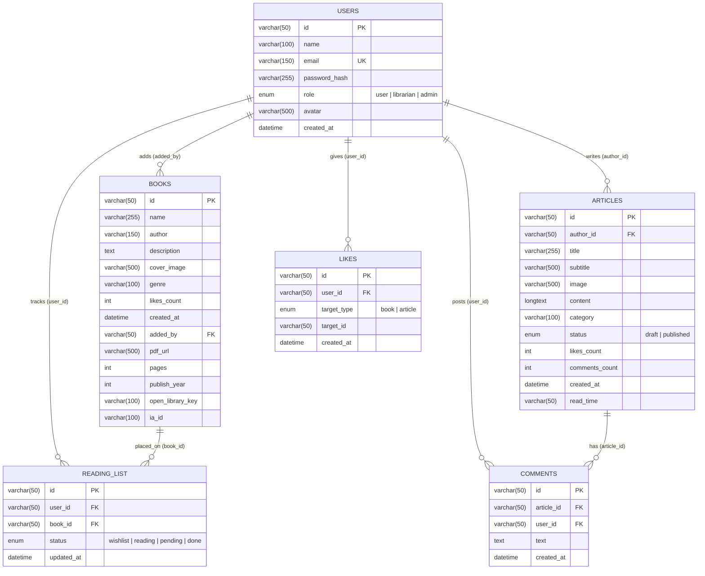

# 🗄️ Shabdkunj (Grove of Words) — Database Architecture

This folder contains the complete **MySQL / MariaDB** database implementation for the **Shabdkunj Library Platform**, 100% aligned with the Feature Specification Document and the Next.js Frontend (`types/index.ts`, `lib/api.ts`, and `lib/mock-data.ts`).

---

## 📂 Files Included

| File | Description |
| :--- | :--- |
| **`schema.sql`** | Creates the `shabdkunj_db` database, all **6 core tables**, **3 SQL Views** (for camelCase frontend JSON mapping), and **4 Automatic Triggers** (for comment/like sync & cleanup). |
| **`seed.sql`** | Seeds the database with the **Admin, Librarian, System, and User accounts**, all **54 curated books** (across 15 genres with Gutenberg PDF & Internet Archive IDs), **6 articles**, comments, likes, and reading board items. |
| **`queries.sql`** | Ready-to-use SQL queries for all Backend API endpoints (`Top 15`, `Trending in last 7 days`, `Search`, `Drag-and-Drop Reading Board Upsert`, etc.). |

---

## 🔗 Entity-Relationship (ER) Diagram



---

## 🚀 How to Run the Database Locally

```bash
# 1. Create the database, tables, views, and triggers
mysql -u root -p < database/schema.sql

# 2. Load the 54 books, users, articles, comments, and reading board data
mysql -u root -p < database/seed.sql
```